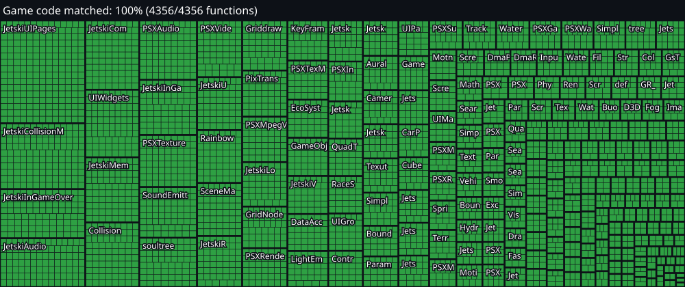

# Splashdown

[](docs/progress/progress.json)
[](#building-the-matching-executable)
[](ports/)

A matching decompilation of **Splashdown** (PlayStation 2, Rainbow Studios, 2001), NTSC-U `SLUS_202.23`, and native ports built from it.

Every game function is C++ that the original compiler turns back into the retail bytes, and the whole executable rebuilds byte-identically from source. The same sources build for x86-64 Linux, where the game plays in full at 30 FPS.

[](docs/progress/progress.json)

## Status

| | |
|---|---|
| Game functions matched | **4,356 / 4,356** (1,772,240 bytes, 100%) |
| Rebuild | `make` and `make link` both reproduce SHA-1 `496ba6a5bfe9d7e68ea2edb993b493033ccc9bae` |
| Source layout | 239 whole translation units in `src/tu/`, one per original source file, code *and* data |
| Shiftable | `make relink` links from `config/link_order.txt` alone, with no fixed addresses |
| SDK | 839 Sony SDK / libgcc / newlib / crt0 functions stay as asm, split from your baserom at build time |
| Ports | Linux x86-64 plays the whole game; see [ports](#ports) |

- **Matched** means the exact retail compiler (Metrowerks `mwccps2` 2.4.1.01 at `-O4,p`), given our source, emits the same bytes as retail. That includes relocation targets and addends. `tools/match.py` checks this mechanically, and `make match` re-checks every file marked `// MATCHED`.
- The map above has one block per translation unit and one cell per function, green when matched.
- New here? Start with [`docs/contributing.md`](docs/contributing.md).

## Ports

Ports live in [`ports/`](ports/). Each one is a platform layer that builds the unchanged game sources from `src/tu/` for another machine.

| Target | Directory | Status |
|---|---|---|
| Linux x86-64 | [`ports/pc`](ports/pc/) | ✅ Whole game at 30 FPS: every track and mode, audio, gamepads, saves, movies |

See [`ports/README.md`](ports/README.md) for how a port is put together and how to add one.

## What you need (not in this repo)

- Your own legally owned copy of the game, dumped by you.
- The retail executable copied from your dump into `baserom/` (gitignored, never committed).
- For a port, a disc image of that dump (2048-byte sectors, ISO9660). The port reads the game's data from it at run time.

Nothing extracted from the disc is committed or redistributed here: no executable, textures, audio or disassembly. The repo holds only tooling and hand-written source. The retail executable is a plain, unencrypted ELF, and nothing here breaks or works around copy protection.

## Building the matching executable

Arch Linux shown here. On other distros you need any `mipsel` GNU binutils.

```sh
cp /path/to/your/dump/SLUS_202.23 baserom/          # SHA-1 496ba6a5bfe9d7e68ea2edb993b493033ccc9bae
# toolchain/mwcps2-2.4-001213/ (decomp.me's mwcps2-2.4-001213) + toolchain/wibo (decompals/wibo release)
yay -S mipsel-linux-gnu-binutils-minimal
uv venv .venv && uv pip install --python .venv 'splat64[mips]'

make setup   # check prerequisites
make         # split → assemble → link → SHA-1 check
make match   # re-verify every MATCHED function against retail
make link    # link the C objects (code + data) in place of the asm, same SHA-1 check
make relink  # after make link: link from config/link_order.txt alone, SHA-1 check, shift test
tools/match.py src/tu/Water.cpp   # check one file
```

## Playing on PC (Linux, x86-64)

```sh
sudo pacman -S clang sdl3 ffmpeg zlib   # ffmpeg is optional: without it movies are skipped
make link                               # once: the port takes the VU microcode packets from it
python3 tools/port/build.py -j 8        # builds build/port/splashdown
SPLASHDOWN_DISC=/path/to/splashdown.bin build/port/splashdown
```

Saves go to `~/.local/share/splashdown/memcard0/` (set `PORT_MEMCARD_DIR` to move them). A CPU with AVX2 is recommended for full speed. Controls and switches are in [`ports/pc/README.md`](ports/pc/README.md).

## Layout

```
src/tu/            whole translation units, one per original source file (zlib/ and msl/ too)
src/<Class>/       shared class headers, named from the retail symbol table
include/           SDK and compiler headers, asm macros
config/            splat config, link order, SDK object list
tools/             matching, linking and progress scripts
tools/port/        build and test tooling for the PC port
ports/             platform layers: pc/ (Linux x86-64)
docs/              contributor guide, progress map
baserom/           your dump's executable (local only, gitignored)
asm/, assets/      generated by splat from the baserom (gitignored)
```

## Toolchain

- Metrowerks `mwccps2` 2.4 (`mwcps2-2.4-001213` from decomp.me's compiler package), the exact retail compiler, run under [wibo](https://github.com/decompals/wibo). A 2.3 build, patched by `tools/mwcc_zlib/`, compiles zlib.
- [splat](https://github.com/ethteck/splat) splits the binary (`config/splat.yaml`), and GNU `mipsel` binutils assemble and link it.
- PC port: clang (C++20 for `ports/pc/`, gnu++98 for the game), SDL3, OpenGL (presentation only), libavcodec, zlib.

## Legal

This project is not affiliated with or endorsed by Rainbow Studios, Infogrames/Atari or Sony. Splashdown is a trademark of its respective owners. You need your own copy of the game to build or play anything here. The aim is preservation and interoperability. The original game's code, data and assets belong to their owners, and nothing here grants any rights to them. Please don't ask for or share game files, disc images or SDKs in issues.
